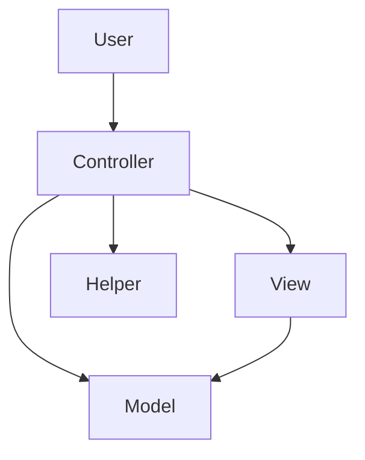
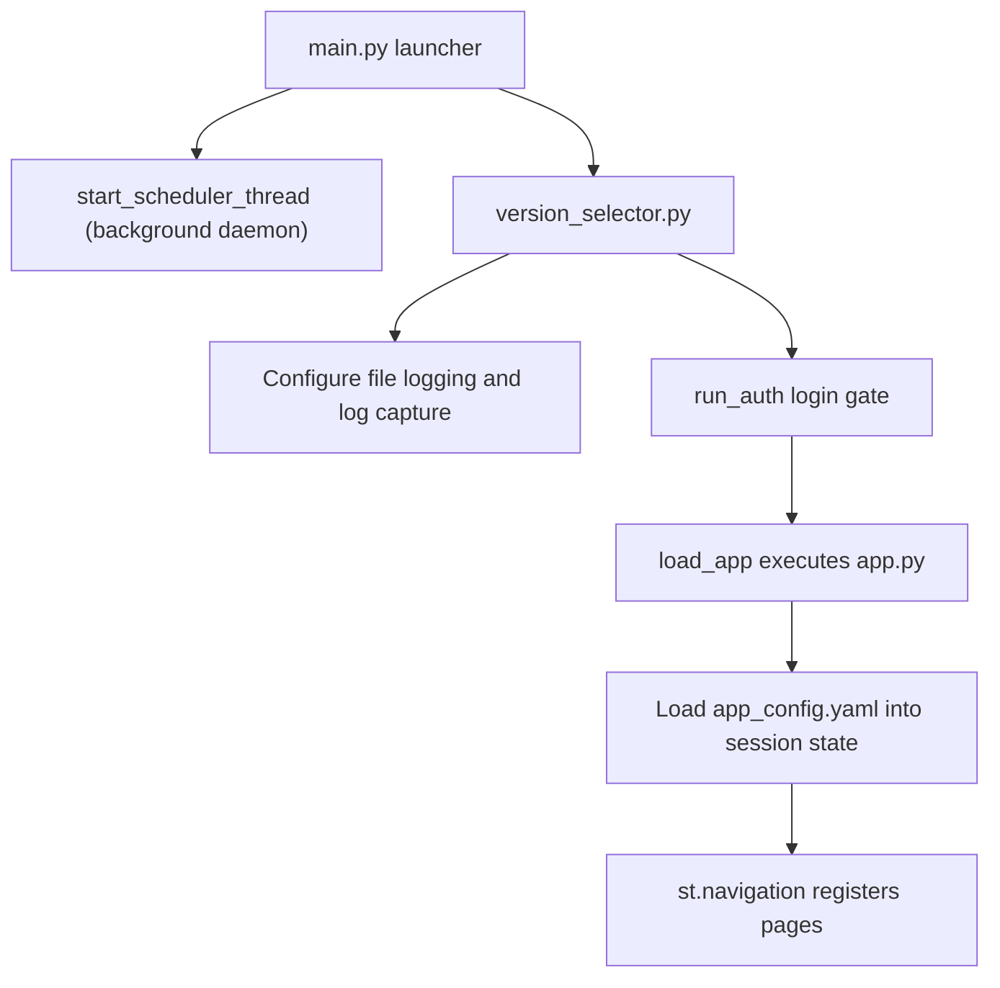

# Architecture

The repository holds one Python package, `equities_frontend`, that contains both the Streamlit web app and the ingestion pipeline. Code is organised by topic and follows the a.s.r. Model View Controller (MVC) convention.

## Repository layout

```text
equities_rag_pipeline/                  repository root
├── equities_frontend/                  application package
│   ├── main.py                         launcher; starts the background scheduler, then Streamlit
│   ├── version_selector.py             logging, login gate, loads app.py
│   ├── deployment_env.py               single source of truth for the active deployment block
│   ├── app.py                          config bootstrap and page router
│   ├── helpers.py                      Data Lake managers, uploads, log capture
│   ├── create_user.py                  CLI to add a user to auth_config.yaml
│   ├── configs/                        all YAML configuration
│   ├── assets/                         static assets (logo)
│   ├── auth/                           login gate and user management
│   ├── admin/                          admin-only user management page
│   ├── chat/                           chat page, RAG orchestration, session store
│   ├── companies/                      company overview and detail pages
│   ├── dcf/                            discounted cash flow model builder
│   ├── index/                          index browser page
│   ├── kpi_monitor/                    KPI Monitor tab: LLM review of a company's model against its transcripts
│   ├── investment_case/                investment case builder
│   ├── portfolio_dashboard_view.py     hosts the colleague's Portfolio Dashboard as a page
│   ├── portfolio_dashboard/            vendored Bloomberg portfolio-analytics dashboard (unmodified)
│   │   └── chat_context_model.py       our own file: portfolio summaries + Chat/case grounding
│   ├── scheduler/                      hourly background thread (classification, portfolio sync, backup)
│   ├── upload/                         single and bulk document upload
│   ├── search/                         Azure AI Search and Foundry retrieval primitives
│   ├── database/                       local SQLite cache of indexed metadata and portfolio data
│   └── vectorization/                  ingestion pipeline on the AVB AI Toolkit
│       ├── main.py                     pipeline CLI entry point
│       ├── company_resolution.py       post-enrichment name/ticker canonicalization
│       ├── extraction/                 financial-model-aware extractor
│       └── financial_model/            Bloomberg model parser
├── deploy/                             Azure DevOps pipeline definitions
├── docs/                               this documentation
├── Dockerfile                          container image build
├── requirements.txt                    pinned runtime dependencies for the image
└── pyproject.toml                      project metadata, dependencies, tool config
```

## Model View Controller layout

Each topic folder holds one controller plus its model, view, and helper files. The responsibilities and dependency rules are fixed.

| Component | File pattern | Responsibility | May call |
|-----------|--------------|----------------|----------|
| Model | `*_model.py` | Calculations and pure data transforms on minimal input types. Knows nothing about datasets. | nothing |
| View | `*_view.py` | Visualisations and Streamlit widgets. May read data from a model. | model |
| Controller | `*_controller.py` | The glue. Wires dataset-specific data into models and views. Slices and filters only, never calculates. | model, view |
| Helper | `helpers.py` | Purely technical utilities such as file reads and Data Lake access. | nothing |

The dependency direction is strictly hierarchical and never inverted.



A model never calls a view or a controller, a view never calls a controller, and a controller performs no calculations. The [development](development) page lists the full review checklist.

## Application startup flow

The web app boots through three files. `main.py` is a thin launcher that also starts the background scheduler thread (see below) before it launches Streamlit, `version_selector.py` sets up logging and the login gate, and `app.py` loads configuration and registers the pages.



The deployment environment is fixed in code by the `DEPLOYMENT_ENVIRONMENT` constant in `deployment_env.py`, imported by both `version_selector.py` (the Streamlit session) and `scheduler/scheduler_model.py` (which runs in a plain background thread with no Streamlit session to read it from). That value selects which environment block from `app_config.yaml` is used as the active `deployment` block. See [configuration](configuration).

## Background scheduler

`main.py` starts an hourly daemon thread (`scheduler/scheduler_controller.py`) alongside the Streamlit subprocess, unless `EQUITIES_SCHEDULER_ENABLED=false`. Each tick: classifies newly-seen companies by region and GICS sector (`companies/company_controller.py`), refreshes the colleague's Portfolio Dashboard data and summarizes it into the local cache (see [frontend-pages](frontend-pages)), then backs the whole local SQLite cache up to the Data Lake. On a cold start with an empty cache, it restores the most recent backup first.

There is no cross-instance coordination — if the deployment ever scales to multiple containers, every instance runs the same tick independently, every hour. This is safe because every write the scheduler makes is idempotent (companies keyed on ticker, portfolio metrics keyed on portfolio + date), so redundant work across instances is bounded, not corrupting.

## Vendored Portfolio Dashboard

`equities_frontend/portfolio_dashboard/` is a colleague's independent Streamlit dashboard (Bloomberg attribution, tracking-error/risk, and factor exposure reporting), copied in wholesale and kept internally unmodified — its `dashboard/`, `datalake/`, `optimizer/`, `reports/`, and `config/` subpackages, and its own `app_config.yaml`, are excluded from this repo's `ruff`/`ty` checks (see `pyproject.toml`). `portfolio_dashboard_view.py` is the only new file wiring it into this app's page navigation; `chat_context_model.py`, in that same directory but not excluded from linting, is the only other new code there — it connects the vendored dashboard's data to Chat and the Investment Case Builder. New code in this repo prefers `polars` over `pandas`; the vendored package's own internal use of `pandas` at its Plotly-rendering boundary is left as delivered.

## Two runtimes, one package

The same package is used two ways. The **frontend** runtime is served by Streamlit and is interactive — the background scheduler above runs inside this same process, as a thread, not as a separate runtime. The **vectorization** runtime is a batch command line job invoked as `python -m vectorization`. Both read the same `configs/config.yaml` and write to or read from the same Azure AI Search index, which keeps ingestion and retrieval in agreement on the index schema and the enrichment fields.
