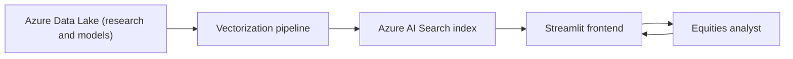

# Equities Research RAG

Equities Research RAG is an internal a.s.r. Vermogensbeheer application that lets the Equities desk search and chat with its own research library in natural language. It indexes broker research notes and Bloomberg financial models into Azure AI Search and serves answers through a Streamlit web app, with every answer grounded in the retrieved source documents.

RAG stands for retrieval-augmented generation: instead of answering from a language model's memory, the app first retrieves the most relevant document chunks from a search index and then asks the model to answer using only that retrieved context. This keeps answers current and traceable to a named source.

## What it does

The product has two halves that share one search index and one configuration set.

- The **frontend** is a multi-page Streamlit app (`equities_frontend/`). It provides a history-aware chat page, a per-company overview, an investment case builder, a discounted cash flow (DCF) model builder, a vendored portfolio-analytics dashboard, an index browser, and document upload pages — plus a background scheduler thread that runs hourly, classifying newly-seen companies, syncing portfolio data, and backing up its local SQLite cache to the Data Lake.
- The **vectorization pipeline** (`equities_frontend/vectorization/`) is the ingestion side. It reads documents from the Azure Data Lake, enriches them with company and document metadata, chunks and embeds them, and uploads the result to Azure AI Search.

## How it is put together

The application is built on the AVB AI Toolkit, the internal a.s.r. packages `avb_llm` and `avb_search`. The toolkit provides the chat, embedding, retrieval, document extraction, and index management building blocks; this repository adds the equities-specific enrichment, company resolution, Bloomberg model parsing, and the Streamlit interface.

## Key capabilities

- **History-aware chat**: follow-up questions are rewritten into standalone queries before retrieval, so a question like "what about its margins?" resolves to the company discussed earlier in the conversation.
- **LLM metadata enrichment**: each document is tagged with the companies it is about, its date, its publisher, and its document type, field-driven off the search index schema itself.
- **Company resolution**: company names newly extracted during upload are fuzzy-matched against the companies already known to the app, so near-duplicate spellings collapse onto one canonical ticker and name.
- **Bloomberg model extraction**: model exports are parsed into one searchable record per metric and period, each with a full metric breadcrumb, a period end date, and a reported or estimate flag.
- **Portfolio data grounding**: Chat and the investment case builder ground answers in real portfolio holdings, risk, and factor exposures — synced hourly from a colleague's vendored Bloomberg portfolio-analytics dashboard — via a direct structured lookup rather than retrieval.
- **Grounded generation tools**: the investment case builder and the DCF model builder reuse the same retrieval layer to draft analyst deliverables from indexed research.

## In this documentation

- Read [getting-started](getting-started) to install dependencies and run the app.
- Read [architecture](architecture) for the code structure and the Model View Controller layout.
- Read [configuration](configuration) for the config files, environments, and feature flags.
- Read [frontend-pages](frontend-pages) for a tour of each Streamlit page.
- Read [retrieval-and-chat](retrieval-and-chat) for how retrieval and answering work.
- Read [vectorization-pipeline](vectorization-pipeline) for the ingestion pipeline and index schema.
- Read [deployment](deployment) for the Docker image and the Azure DevOps pipeline.
- Read [development](development) for coding standards, tooling, and local workflows.
