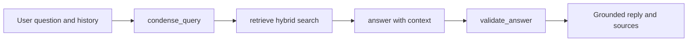

# Retrieval and chat

The chat page, the investment case builder, and the DCF assumption helper all share one retrieval layer in `equities_frontend/search/search_model.py`. This page explains the retrieval-augmented generation (RAG) flow and how chat sessions are persisted.

## The RAG flow

A single answer passes through four steps. The model is only asked to write once the relevant context has been retrieved, and the draft is checked before it is shown.

- **Condense**: `condense_query` rewrites a follow-up question into a standalone query using the conversation history, so pronouns and elisions resolve to the company or topic discussed earlier.
- **Retrieve**: `retrieve` runs a hybrid search that combines a vector similarity search on the embedded query with a keyword search, then returns the top `top_k` chunks. An optional OData filter narrows results by facet.
- **Answer**: `answer` formats the retrieved chunks into a context block with `format_context` and prompts the chat deployment to answer using only that context.
- **Validate**: `validate_answer` checks the draft against the retrieved context before it is returned, guarding against unsupported claims.

## Retrieval primitives

`search_model.py` exposes the building blocks used across the app.

| Function | Role |
|----------|------|
| `get_chat_client` | Builds the Azure AI Foundry chat client. |
| `get_search_client` | Builds the Azure AI Search client. |
| `get_facets` | Reads facet values for filtering. |
| `build_odata_filter` | Turns facet selections into an OData filter string. |
| `retrieve` | Hybrid vector and keyword retrieval of chunks. |
| `retrieve_financial_model_bulk` | Bulk retrieval of Bloomberg model records. |
| `condense_query` | History-aware query rewriting. |
| `format_context` | Formats chunks for a chat answer. |
| `format_investment_context` | Formats chunks for the investment case builder. |
| `answer` | Generates the grounded answer. |
| `validate_answer` | Checks the answer against its context. |

Retrieved rows are represented as a `Chunk`, and `normalize_publisher` and `format_source_label` produce the human-readable source labels shown under an answer.

## Portfolio-data grounding

Chat and the Investment Case Builder's "Role in the Portfolio" section additionally ground answers in real portfolio data — factor exposures, per-stock weights, and risk — synced hourly from the colleague's Portfolio Dashboard (see [frontend-pages](frontend-pages) and [architecture](architecture)). This bypasses the RAG flow above entirely: exact portfolio numbers need a deterministic lookup, not semantic retrieval.

- `chat_controller.ChatController._portfolio_context_chunk` detects a portfolio named in the question and looks it up directly — `database.cache.get_portfolio_metrics`, defaulting to the latest cached date.
- `investment_case_controller.InvestmentCaseController._portfolio_positioning_chunk` runs the reverse lookup for the company under discussion, fuzzy-matching it against every portfolio's full cached holdings.

Both build a synthetic `search_model.Chunk` from the structured result and prepend it to the normally-retrieved chunks, so it flows through the existing citation numbering and prompt assembly (`format_context` / `format_investment_context`) unchanged, with no new parameters added to `answer()`.

## Chat sessions

Conversations are persisted to the Data Lake by `chat/session_store.py` so that an analyst can close the app and resume later. Sessions are stored per tab under the sessions root, and each session is a single JSON file.

| Aspect | Value |
|--------|-------|
| Sessions root | `LLM/sessions` |
| Session path | `LLM/sessions/<tab>/<session_id>.json` |
| Retention | `MAX_SESSIONS` most recent sessions per tab (`10`) |

`session_store.py` provides `save_session`, `list_sessions` (cached), `load_session`, and `delete_session`, and prunes old sessions beyond the retention limit. The chat view starts a new session, loads a selected one, autosaves after each exchange, and renders the session list in the sidebar. `list_sessions` is cached for responsiveness, so it is cleared after a save or delete to keep the sidebar current.
