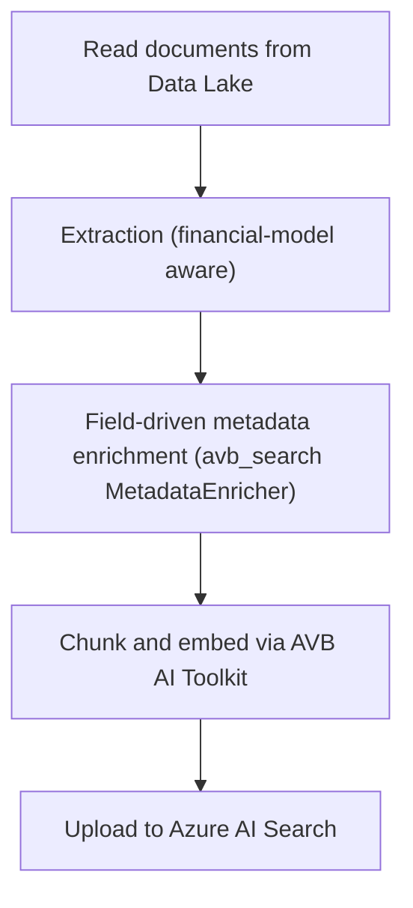

# Vectorization pipeline

The vectorization pipeline turns documents in the Data Lake into searchable records in Azure AI Search. It lives in `equities_frontend/vectorization/` and is built on the AVB AI Toolkit (`avb_llm` and `avb_search`), which supplies the extraction, chunking, embedding, field-driven enrichment, and index-management primitives unchanged; this repository adds only the financial-model-aware extractor and, in the frontend's own upload path, company-name canonicalization.

## Running the pipeline

The pipeline is invoked as a module. `python -m vectorization` calls `run_pipeline_sync()` in `vectorization/main.py`.

```bash
PYTHONPATH=equities_frontend python -m vectorization \
  --index_name equities-research \
  --index_path LLM/indices/equities-research \
  --data_layer silver \
  --config_file equities_frontend/configs/config.yaml \
  --storage_account development \
  --overwrite false
```

The accepted arguments are:

| Argument | Required | Values | Meaning |
|----------|----------|--------|---------|
| `--index_name` | yes | text | Azure AI Search index name. |
| `--index_path` | yes | text | Data Lake path that mirrors the index. |
| `--data_layer` | yes | text | Data Lake filesystem, for example `silver`. |
| `--config_file` | yes | path | Path to `configs/config.yaml`. |
| `--pdf_parsing_method` | no | `pages`, `full-content` | How PDFs are split. Defaults to `pages`. |
| `--overwrite` | no | `true`, `false` | Recreate the index when `true`. Defaults to `false`. |
| `--storage_account` | no | `development`, `acceptance`, `production` | Data Lake account. Defaults to `development`. |

## Pipeline stages

`vectorization/main.py` assembles its parts from configuration: `_build_enricher` and `_build_extractor` construct the optional stages when their feature flags are enabled, and `_build_pipeline` wires them into the avb_search `IndexPipeline`, which owns chunking, embedding, and the upload itself.



The frontend's own ad-hoc upload path (`upload/ingestion_model.py`, used by the Upload Document and Bulk Upload pages) replicates this same flow one file at a time via the `IndexPipeline`'s public methods, and inserts one extra stage the CLI pipeline above does not have: company resolution, between enrichment and chunking (see below).

## Metadata enrichment

Enrichment is native `avb_search` functionality (`avb_search.enrichment.metadata_controller.MetadataEnricher`), not a bespoke module in this repo. It is field-driven: every field in `config.yaml`'s `search_index_configuration.fields` marked `llm_defined: true` (`companies`, `tickers`, `documentDate`, `publisher`, `documentType`) is populated by one LLM call per document, using that field's own `description` to build the structured-output schema — there is no separate prompt-template or field-mapping code to maintain here. `config.yaml`'s `enrichment` block only supplies the tuning: `enabled`, `model` (the chat deployment), `instructions` (a base instruction prepended to the auto-generated "fields to extract" list), and `sample_chars` (how much of each document's text is sent to the model). This stage runs only when `enrichment.enabled` is `true`.

## Company resolution

`vectorization/company_resolution.py` is a single pure function, `resolve_companies`, not a class or a config-driven resolver — it closes a real gap the enricher's own per-document LLM call leaves open: two documents about the same company can independently come back tagged "Nike, Inc." and "NIKE Incorporated", with no memory of each other. `resolve_companies` takes one segment's raw `(names, tickers)` pairs plus the companies already known to this app (`database.cache.get_all_companies()`, kept fresh by the hourly scheduler's classification job) and replaces near-duplicate spellings with the canonical name/ticker already on record — an exact ticker match first, then a `rapidfuzz.fuzz.WRatio` name match at a fixed `DEFAULT_FUZZY_THRESHOLD` of `80`. An entry with no match on either path is left exactly as the enricher produced it.

Because it depends on the frontend's own local companies cache, this step only runs in the frontend's upload path (`upload/ingestion_model.py::_ingest_one`), between enrichment and chunking — not in the standalone `python -m vectorization` CLI pipeline above, which has no such cache to resolve against.

## Financial model extraction

Bloomberg model exports are recognised by the `MODL_` filename prefix and parsed by `financial_model/`. `extract_financial_model` reads the workbook starting at `data_start_col` (`4`) and emits one record per metric and period, each carrying a full metric breadcrumb, a `periodEndDate`, and an `isEstimate` flag distinguishing reported from estimated values. This stage runs only when `financial_model_extraction.enabled` is `true`.

A standalone CLI inspects a single model without touching the index:

```bash
PYTHONPATH=equities_frontend python -m vectorization.financial_model.cli \
  --file path/to/MODL_example.xlsx --show-paths
```

## Index schema

The index schema is defined authoritatively in `config.yaml` under `search_index_configuration`. It declares 19 fields spanning document metadata, company tags, and financial-model dimensions; each field's `llm_defined` flag decides whether metadata enrichment populates it.

| Group | Fields |
|-------|--------|
| Document metadata | `title`, `author`, `extension`, `publisher`, `documentDate`, `documentType`, `sourceType` |
| Company tags (`llm_defined`) | `companies`, `tickers` (both string collections) |
| Financial model | `metric`, `periodLabel`, `periodEndDate`, `periodicity`, `isEstimate`, `currency`, `unit`, `segment`, `tableRow`, `tableRowsTotal` |

Vector search uses the `vec-prof` profile with the `hnsw` algorithm and `3072` dimensional embeddings, matching the `text-embedding-3-large` deployment. Because the schema is shared between ingestion and retrieval, both sides stay in agreement on field names and types.
